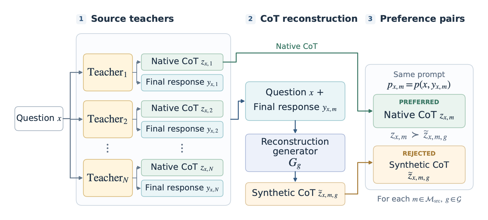

# Learning Teacher Output Preferences from Final Responses for Reasoning Distillation

This is the official repository for the paper **Learning Teacher Output Preferences from Final Responses for Reasoning Distillation** by Hongli Shen, Shaopeng Fu, Qinbo Zhang, Jian Li, and Di Wang.

## Hugging Face Resources

- [HardTests DPO training dataset](https://huggingface.co/datasets/renmiamu/FOPL)
- [FOPL-DPO model weights](https://huggingface.co/renmiamu/FOPL-dpo)

## Pipeline

[](assets/cot_pipeline.pdf)

## Environment Setup

Use Python 3.10+ on a Linux machine with a CUDA-compatible PyTorch build. Install the project dependencies and vLLM for serving local models:

```bash
pip install -r requirements.txt
pip install vllm
```

Configure the model endpoints and identifiers in `configs/model_configs.json`, and set the API keys for the profiles you use:

```bash
export OHMYGPT_API_KEY=...
export DASHSCOPE_API_KEY=...
export MIMO_API_KEY=...
```

The supplied profiles are examples from the research environment. Run the commands below from the repository root. Checkpoints, caches, and evaluation results are created when needed and ignored by Git.

## Data Preparation

### 1. DPO preference data

The released HardTests DPO dataset contains 6,928 preference pairs from 433 complete problems before tokenizer length filtering. Each record includes `prompt`, `chosen`, `rejected`, and provenance fields.

Download the training JSON from the [HardTests DPO dataset on Hugging Face](https://huggingface.co/datasets/renmiamu/FOPL) and save it as `data/hardtests_dpo.json` to use the training command below.

To regenerate the dataset, preview the workload or run the full pipeline. The default teacher families are DeepSeek-V4-Pro, GLM-5.2, Kimi-K2.5, and Qwen3-235B-A22B-Thinking-2507.

```bash
python scripts/build_hardtests_dpo_pipeline.py --dry-run
python scripts/build_hardtests_dpo_pipeline.py --stage all --limit 500 --workers 4
```

The builder pins a problem snapshot, resumes from JSONL checkpoints, and writes the regenerated data to `data/dpo_pipeline/hardtests/hardtests_dpo.json`. Pair counts may vary with API responses.

### 2. Build student training data

Collect native traces and final responses, then reconstruct from the saved final responses with the trained local policy served at `http://localhost:8000/v1`:

```bash
python scripts/build_openr1_math_sft.py \
  --stage reference --reference-profiles deepseek_v4_pro \
  --limit 5000 --workers 4

python scripts/build_openr1_math_sft.py \
  --stage reconstruct --reference-profiles deepseek_v4_pro \
  --local-reconstruction-only --local-served-model-name reconstructor \
  --limit 5000 --workers 4
```

The corresponding training files are `data/sft/deepseek_v4_pro_ref.json` and `data/sft/local_reconstruction_syn_from_deepseek_v4_pro.json`. For a final-response-only control, run:

```bash
python scripts/build_openr1_math_sft.py \
  --stage final-only --reference-profiles deepseek_v4_pro
```

This writes `data/sft/deepseek_v4_pro_final_only.json`. For prompted-reconstructor ablations, use `--stage reconstruct` with the desired `--reconstruction-profiles` and `--no-local-reconstruction`.

## Training

### 1. Train the reconstruction policy

```bash
deepspeed src/full_dpo.py \
  --config configs/full_dpo_config.json \
  --model /path/to/reconstructor-base-checkpoint \
  --data-path data/hardtests_dpo.json \
  --output-dir outputs/reconstructor_dpo
```

To train on regenerated data, pass `--data-path data/dpo_pipeline/hardtests/hardtests_dpo.json`.

The DPO configuration uses 3 epochs, learning rate `1e-5`, a cosine schedule, 5% warmup, per-device batch size 1, gradient accumulation 8, maximum length 16,384, maximum prompt length 8,192, beta 0.1, bfloat16, and seed 42. Pairs exceeding the token limit are dropped as units. Use `--resume-from-checkpoint` to resume training.

The trained [FOPL-DPO model weights](https://huggingface.co/renmiamu/FOPL-dpo) are available on Hugging Face. Serve your checkpoint before generating student data or running the similarity evaluation:

```bash
vllm serve outputs/reconstructor_dpo --served-model-name reconstructor --port 8000
```

### 2. Train the student

Train each condition from the same student initialization and with a separate output directory:

```bash
python src/full_sft.py \
  --config configs/full_sft_config.json \
  --model /path/to/Qwen2.5-1.5B-base \
  --data-path data/sft/local_reconstruction_syn_from_deepseek_v4_pro.json \
  --output-dir outputs/student_reconstructed

python src/full_sft.py \
  --config configs/full_sft_config.json \
  --model /path/to/Qwen2.5-1.5B-base \
  --data-path data/sft/deepseek_v4_pro_ref.json \
  --output-dir outputs/student_native
```

The SFT configuration caps rows at 5,000 and uses 3 epochs, learning rate `1e-5`, a cosine schedule, 5% warmup, per-device batch size 1, gradient accumulation 8, maximum length 32,768, bfloat16, and seed 42. Check matched problem IDs and record the actual sample count for each condition.

## Evaluation

### 1. Cross-model reasoning similarity

For each native reference family, the same local policy reconstructs a trace from that family's final response and traces from alternative families' responses. An LLM judge compares the matching-source trace with each alternative. A problem is retained only when the reference and both response sources have the same normalized boxed final answer. MiMo is included here as a held-out response source, not in DPO preference training.

```bash
python evaluation/evaluate_cross_model_similarity.py \
  --reconstruction-model reconstructor \
  --reconstruction-base-url http://localhost:8000/v1 \
  --judge-profile gpt_5_6_luna \
  --generation-workers 4 --workers 4
```

Use `--stage generate` and `--stage judge` to run generation and judging separately. For a small API check, add `--limit 2` and a separate `--pipeline-dir`. The matrix is written to `evaluation/llm_judge/cross_model_similarity/cross_model_similarity_matrix.json`; individual judgments and win/loss/tie counts are under `judgments/`. A win scores 1 and a tie 0.5. Diagonal cells aggregate comparisons against all alternatives; each off-diagonal cell covers one alternative.

### 2. Student benchmarks

Serve each student checkpoint on port 8000 with the same served model name and decoding options, then write results to separate files:

```bash
python evaluation/evaluate_gsm8k.py --model student --base-url http://localhost:8000/v1 --grader math_verify --output evaluation/results/student_gsm8k.json --resume
python evaluation/evaluate_math500.py --model student --base-url http://localhost:8000/v1 --grader math_verify --output evaluation/results/student_math500.json --resume
python evaluation/evaluate_gpqa.py --model student --base-url http://localhost:8000/v1 --output evaluation/results/student_gpqa.json --resume
python evaluation/evaluate_svamp.py --model student --base-url http://localhost:8000/v1 --output evaluation/results/student_svamp.json --resume
python evaluation/evaluate_openbookqa.py --model student --base-url http://localhost:8000/v1 --output evaluation/results/student_openbookqa.json --resume
```

AdvBench also requires a Llama Guard server, for example on port 8001:

```bash
python evaluation/evaluate_advbench.py \
  --model student --base-url http://localhost:8000/v1 \
  --guard-model llama-guard --guard-base-url http://localhost:8001/v1 \
  --output evaluation/results/student_advbench.json --resume
```

AdvBench reports `safe / (safe + unsafe)` and judge coverage; unknown Guard judgments are counted separately. GPQA uses the Diamond split, and OpenBookQA uses the `main` test split. All evaluation scripts accept `--limit` for a quick run.

## Reproducibility Notes

The configs retain the reported hyperparameters, but the exact executed checkpoint IDs, hardware, and tokenizer-filtered DPO counts require the original run logs. Pass `--model` when an exact base checkpoint is needed. Benchmark results depend on the model server, dataset access, judge checkpoint, and decoding settings; this repository does not include model weights or result JSON files.

Run the remaining offline checks with:

```bash
python -m unittest evaluation.test_evaluate_multiple_choice
```
